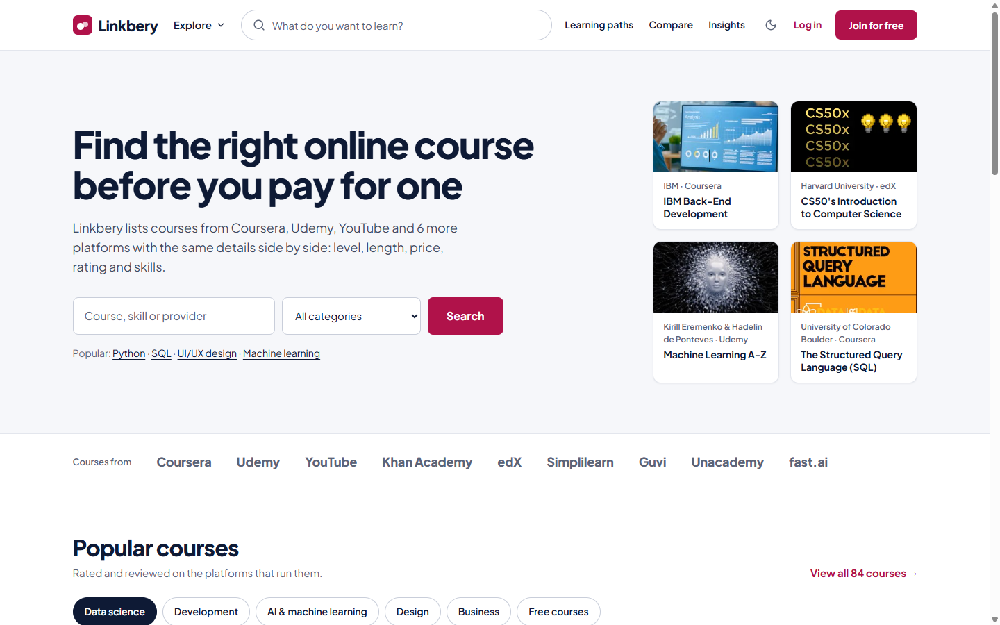
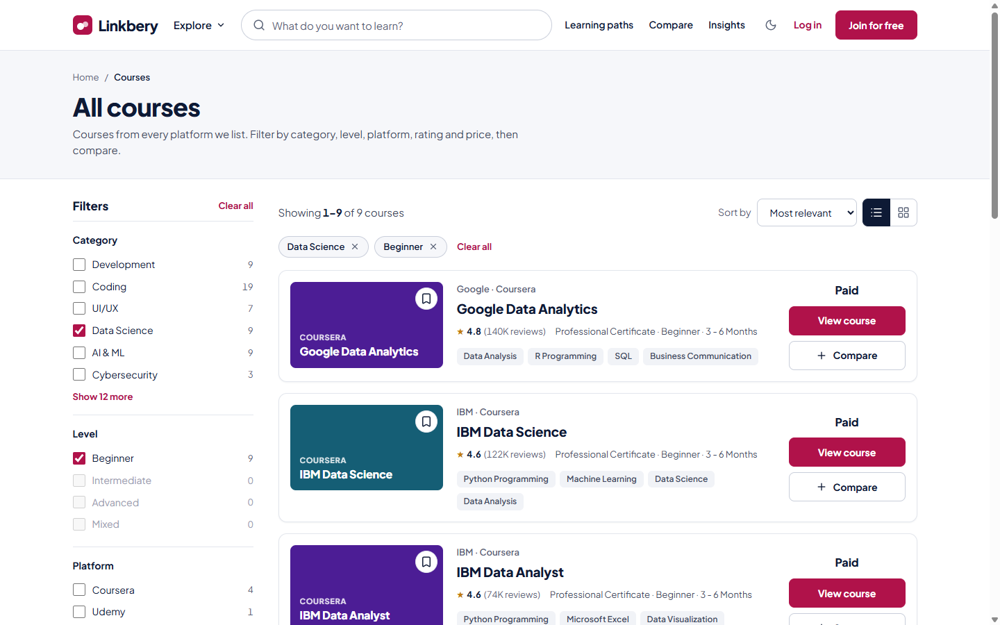
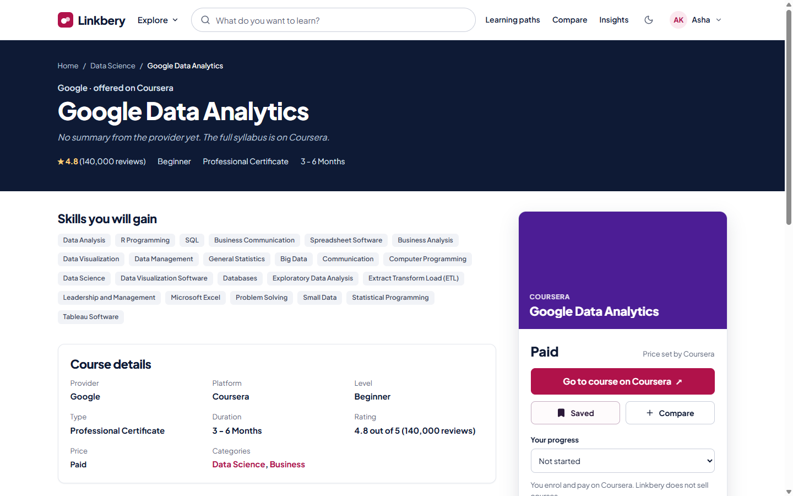
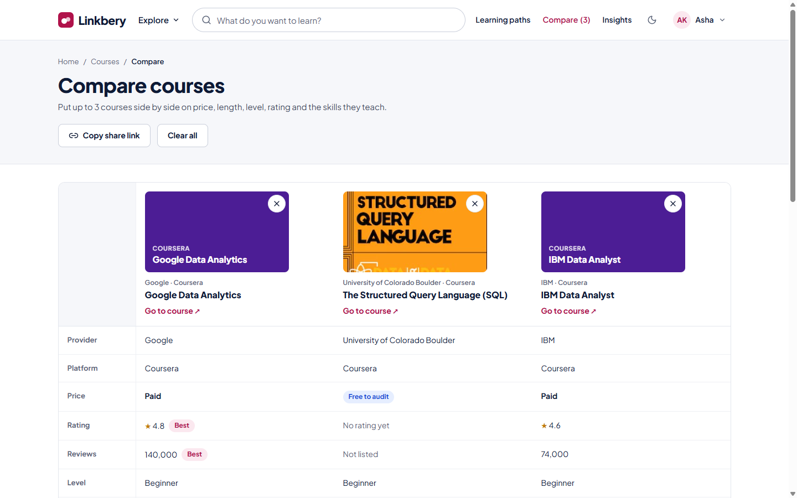
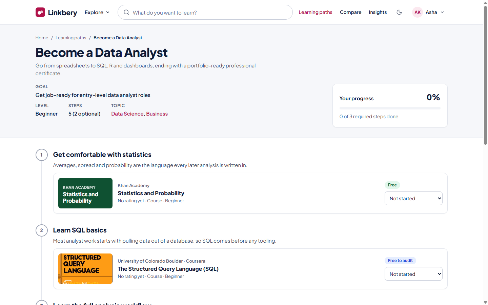
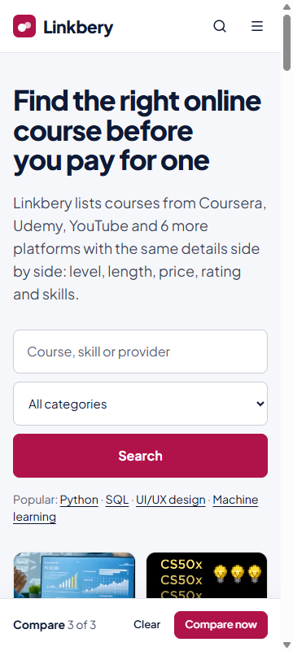

# Linkbery

**Find the right online course before you pay for one.**

Linkbery is a course aggregator. It collects online courses from Coursera, Udemy,
edX, YouTube, Khan Academy, Simplilearn, Guvi, Unacademy and fast.ai, describes them
all with the same details (level, length, price, rating and skills) and lets students
search, compare and plan their learning in one place. Linkbery doesn't host or sell
courses: every "Go to course" button takes you to the provider to enrol.



## Features

| | |
|---|---|
| **Search and filters** | Search 84 courses by title, skill or provider. Filter by category, level, platform, rating and price, with live counts. Filtered views are kept in the URL, so they can be shared. |
| **Course pages** | Every detail in one place: provider, platform, level, duration, price, rating, skills, related courses and the learning paths the course belongs to. |
| **Compare** | Put up to 3 courses side by side. Shared skills are highlighted and the best rating is marked. Share a comparison with a link. |
| **Learning paths** | 8 step-by-step routes such as *Become a Data Analyst* or *Become a Web Developer*, built from courses across platforms. |
| **Progress tracking** | Mark courses as Planning, In progress or Completed and see how far along each path you are. |
| **Recommendations** | Describe a goal ("learn ml with python") and get matching courses with the reason each was picked. |
| **Platform insights** | Course counts, average ratings and top skills for each platform. |
| **Accounts** | Register, log in, save courses and edit your profile and photo. |

The site works on phones down to 360px wide and has a light theme (default) and a dark theme.

> **Note:** login is a demo. There is no server: accounts, saved courses and progress
> are stored in your browser's `localStorage`, on this device only. Don't use a real password.

## Screenshots

| Courses with filters | Course page |
|---|---|
|  |  |

| Compare | Learning path |
|---|---|
|  |  |

<p align="center"></p>

## Getting started

You need [Node.js](https://nodejs.org/) 20 or newer.

```bash
git clone https://github.com/nithinskumar866/linkbery-groupproject.git
cd linkbery-groupproject/app
npm install
npm run dev
```

Then open http://localhost:5173.

| Command | What it does |
|---|---|
| `npm run dev` | Start the development server |
| `npm test` | Run the unit tests (67 tests, Vitest) |
| `npm run lint` | Check the code (oxlint) |
| `npm run build` | Build the production site into `app/dist/` |
| `npm run data` | Rebuild the course list from the source data |

## Tech stack

- **React 19** with **Vite** and **React Router**
- Plain CSS with design tokens (`app/src/styles/tokens.css`)
- **Lucide** icons and the Plus Jakarta Sans font
- **Vitest** for tests
- No backend: course data is a JSON file, and user data lives in `localStorage`

## Repository layout

```
linkbery-groupproject/
├── app/              the React application (see app/README.md for details)
├── docs/screenshots/ images used in this README
├── legacy/           the original static HTML/CSS site, kept for reference
└── linkbery.csv      source list of Coursera courses
```

Inside `app/`:

| Folder | Contents |
|---|---|
| `src/data/` | `courses.json` (generated) and `paths.json` (learning paths) |
| `src/lib/` | Data and storage logic: search, recommendations, auth, saved courses, compare, paths, progress |
| `src/hooks/` | React hooks over `lib/` |
| `src/components/` | Shared UI: header, footer, course cards, filters, compare bar |
| `src/pages/` | One component per page |
| `scripts/` | The course data build script and extra course data |

Two documents describe how the app is put together:

- [`app/CONTRACT.md`](app/CONTRACT.md): the course data format and every function the UI can call.
- [`app/DESIGN.md`](app/DESIGN.md): the visual design rules, so new pages match the rest of the site.

## Course data

The course list is built from three sources and checked by `npm run data`:

1. `linkbery.csv`: Coursera certificates and specializations
2. courses from the original Linkbery site
3. `app/scripts/sample-courses.json`: extra real courses from other platforms, marked as `sample`

Ratings and review counts come from the providers. Courses without a known rating show
"No rating yet". Course details can change on the provider's site, so always check there
before enrolling.

To add a course or a learning path, see [`app/README.md`](app/README.md#adding-content).

## Deployment

`npm run build` produces a static site in `app/dist/` that any static host can serve.
Single-page app routing is already configured for **Vercel** (`app/vercel.json`) and
**Netlify** (`app/public/_redirects`).

## Known limitations

- Login is demo-only and data doesn't sync between devices.
- Only Coursera courses have ratings, so the other platforms show "n/a" in Insights.
- Four degree programmes in `linkbery.csv` are skipped because their rows contain
  inconsistent data.
